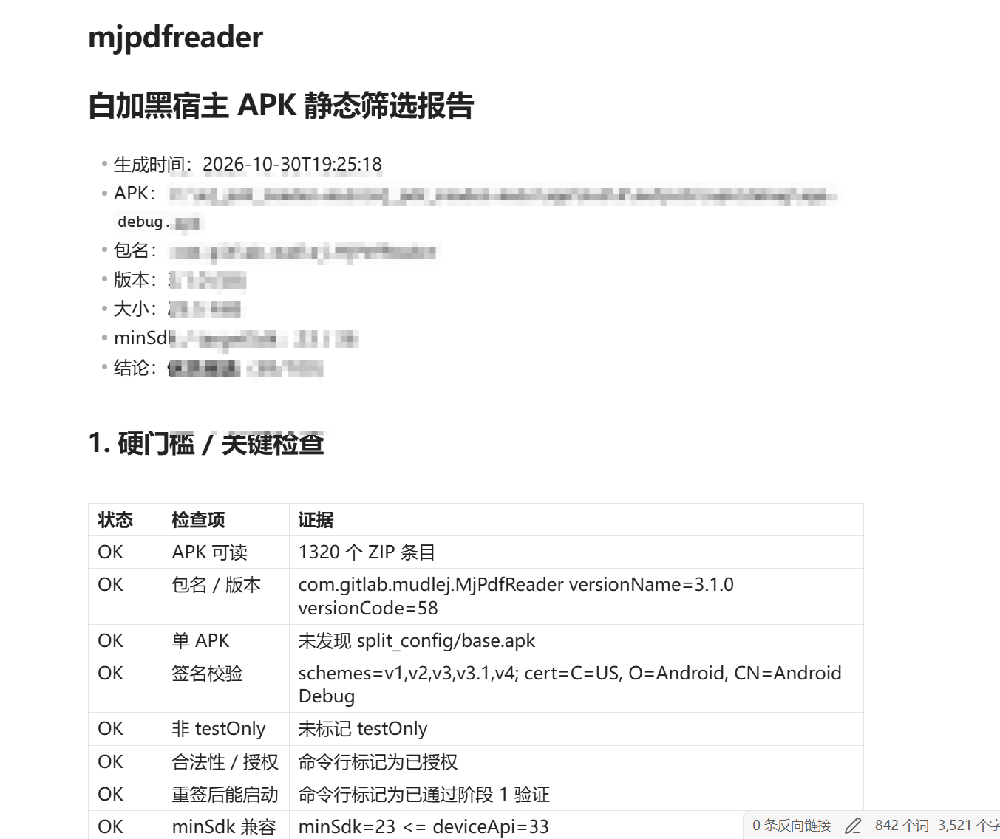
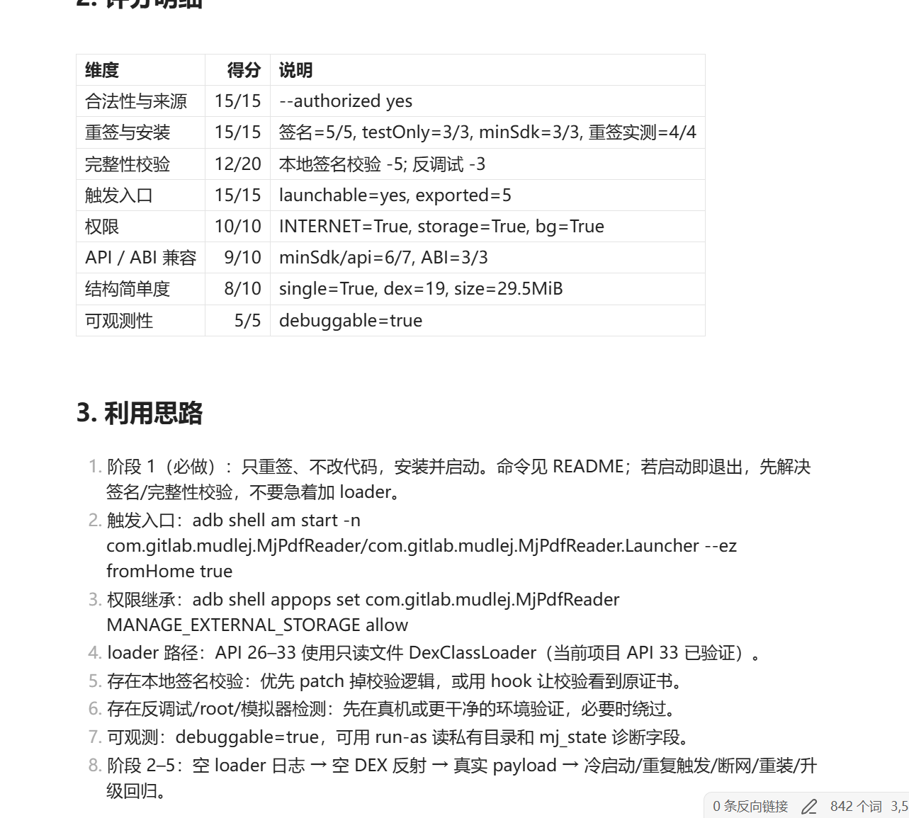
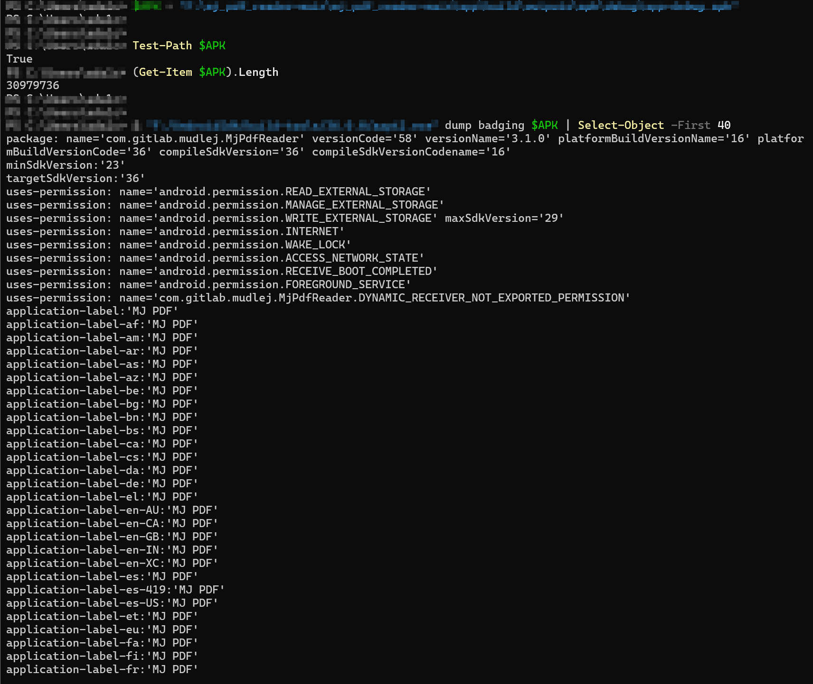
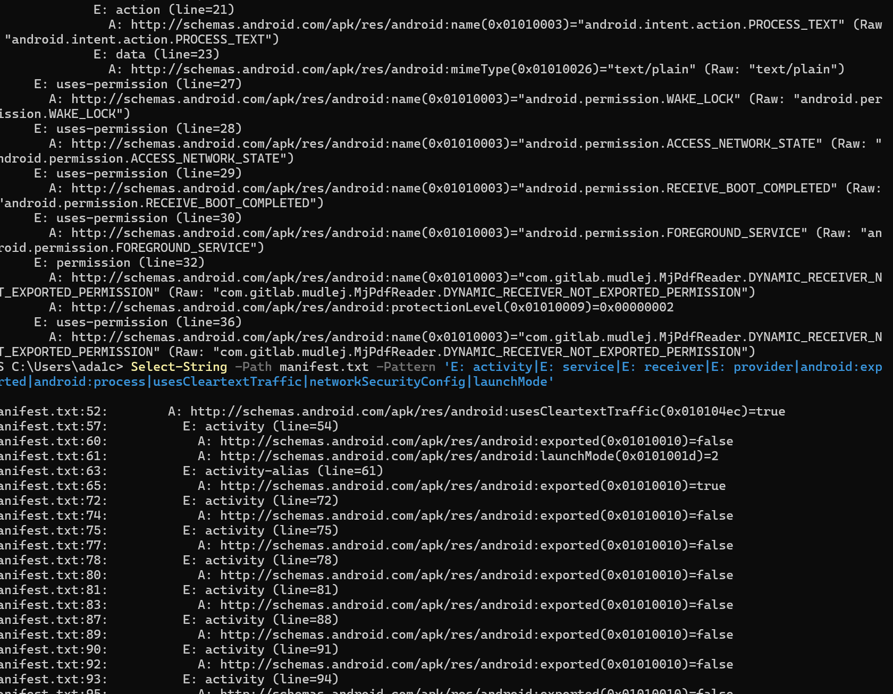
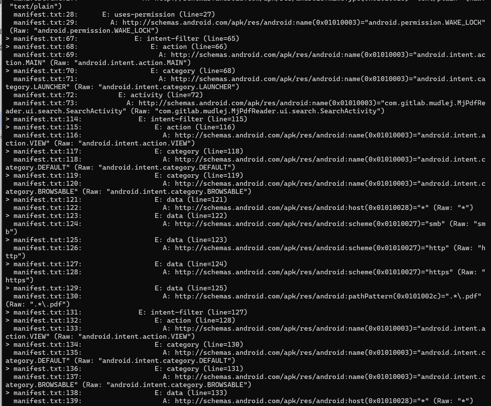
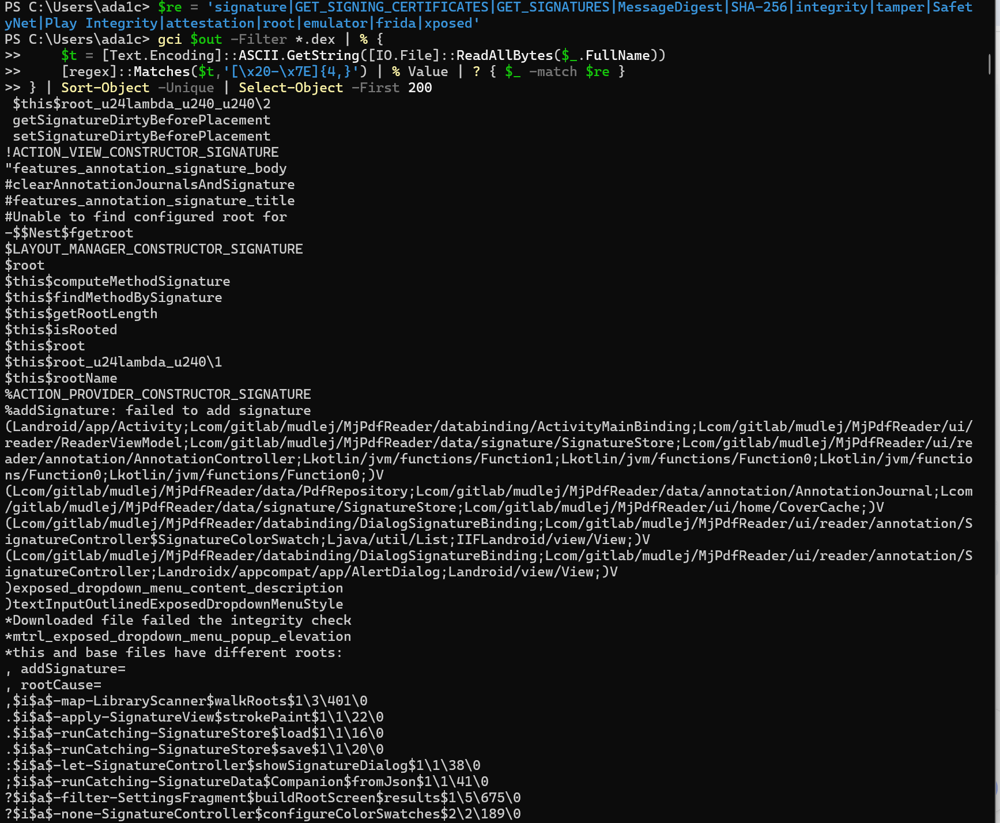
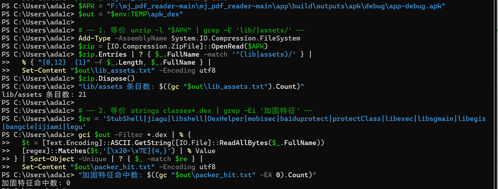
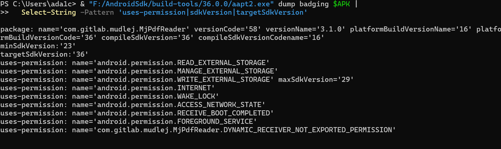

安卓APK思路好像都是白加黑，那么怎么在安卓如此庞大的开源生态里面找到一个适合我们的白壳捏，这就无外乎重签后还能正常启动、能稳定执行到我们放 loader 的位置、不会因为签名/完整性检查自杀的APK。

这篇会记一下怎么选择白壳的思路和白灰黑架构设计，后续第二篇会写一个详细的白加黑回传用户相册的APK，所以本篇就当背景信息补充了orz因为笔者一直都是苹果全家桶，没有安卓实机，加上平常要用到安卓的场景比较少，所以会记一些基本架构和安卓特有的概念。。。。

关于第一部分的白壳APK快速筛选，写了个脚本来给自己以后快速筛()这个脚本会检查:

- ZIP 结构、DEX 数量、so/ABI、split APK
- 包名、版本、minSdk/targetSdk
- 签名方案与证书
- 加固/壳、Play Integrity/SafetyNet、本地签名校验、反调试/root/模拟器检测
- 可触发入口、导出组件
- INTERNET、存储、后台权限
- 明文 HTTP 策略、进程模型、可观测性

会生成这样一个详细报告+利用思路，完整脚本放在github仓库AccompanyingPoC了

看是不是可以作为白加黑载体需要有几个硬性决定:

- 目标设备必须能安装
- 必须是单 APK或者能拿到可独立安装的universal APK
- 重签后必须能正常启动
- 不能存在不可绕过的完整性校验(我检查的适合会静态搜索一下签名校验/Play Integrity/SafetyNet/服务端校验这些
- 不能有加固/壳

实际上必须得先只重签不改任何代码试试，如果重签后都启动不了，就说明签名校验/风控在起作用，后面我们loader是不行的

所以我自己的思路是拿到候选后先看一下许可证和是不是自有或测试包→是单APK还是Split APK、DEX数量以及assets/lib的目录结构→ v1/v2/v3签名/证书信息/重签后能否正常安装启动→判断是否存在壳/签名校验/Play Integrity/服务端校验等完整性保护→有哪些exported组件，验证能否通过 am start 等方式触发入口→审查存储/网络/后台/MANAGE_EXTERNAL_STORAGE权限申请→看minSdk/targetSdk/ABI/API 34+行为差异和明文 HTTP等兼容性风险→评估能不能 logcat读取私有目录

## 筛选

APK30.9 MB，包名com.gitlab.mudlej.MjPdfReader，versionName 3.1.0 / versionCode 58，compileSdk与targetSdk都是 36，minSdk23，应用名MJ PDF且所有语言都写死为 MJ PDF。

这个应用申请了MANAGE_EXTERNAL_STORAGE，这是安卓里面的所有文件访问权限，在 Google Play政策下面只有像文件管理器和备份恢复还有设备管理这些等类别能申请，但是出现在PDF阅读器上属于正常行为。
4.2 Manifest 与组件

接下来看Manifest和组件，我们主要是看:

- Activity 是否exported=true
- 是否有可直接 am start` 的 Activity /am startservice的 Service/可广播的 Receiver
- 是否有多进程（android:process），loader 只会跑在触发的那个进程； targetSdk >= 28且usesCleartextTraffic=false时，HTTP C2 可能被明文策略拦截,usesCleartextTraffic=true显式覆盖了targetSdk=36的默认false，HTTP C2不会被 NetworkSecurityPolicy拦截，剩下要排查的只有设备侧 VPN/代理/防火墙。

可外部触发的入口很少，Activity只有两个exported=true，一个是 LAUNCHER 的 activity-alias（line=61，singleTask），桌面入口，am start -n 包名/alias名 可拉起，另一个是 line=110 的 document activity（documentLaunchMode=intoExisting），处理 ACTION_VIEW/ACTION_SEND 打开 PDF。

其余activity全false

多进程只有主进程和 :acra，ACRA全套组件都显式挂 :acra，主进程下没有子进程，这对 loader影响很大，触发主Activity或document activity才能保证代码跑在主进程，触发那个导出service或ACRA的导出receiver，代码跑在各自声明的进程里，loader 若假定在主进程就会出现进程起来但 hook 没生效。

主进程有一个无界面可以直接广播触发的exported receiver，比只能跑:acra的ACRA receiver 更适合当loader入口。

### 触发方式

DiagnosticsReceiver：am broadcast -a androidx.work.diagnostics.REQUEST_DIAGNOSTICS -n com.gitlab.mudlej.MjPdfReader/androidx.work.impl.diagnostics.DiagnosticsReceiver 无 UI

之前说的ACRA receive没有 intent-filter，只能显式component广播

document activity有四组 VIEW，scheme覆盖smb/http/https/file/content，含.*\.pdf 和 application/pdf）+ 一组 SEND（text/plain）。可用 am start -a VIEW -d "file:///sdcard/test.pdf" -t "application/pdf" -n 包名/<activity>。

LAUNCHER alias ：标准 MAIN+LAUNCHER，am start -n 包名/<alias>。

导出：无 intent-filter、无 foregroundServiceType，只能 am start-foreground-service -n 包名/<service>。

所以这个壳子我们首选DiagnosticsReceiver广播，因为是主进程和无 UI，次选LAUNCHER alias

## 签名校验/完整性校 /风控

反编译后搜关键字jadx/apktool/strings都可以，高风险信号关注这些

- PackageManager.getPackageInfo(...).signatures
- GET_SIGNING_CERTIFICATES / GET_SIGNATURES
- MessageDigest + 证书字节比较
- SafetyNet / Play Integrity / Attestation
- 服务端校验 APK 签名 / 设备指纹
- root / emulator / frida / xposed 检测

只做本地签名比对的可以通过patch掉校验或，做服务端校验或者Play Integrity的改包后可能直接不可用

### 加固 / 壳 / 保护

未加壳，lib/ 下是4 个ABI，全套都是PDFium生态，意味着PDF解析与渲染完全在 native层跑，Java/Kotlin侧只是 UI 壳和调度，对我们的 loader影响很大，想hook PDF渲染这类核心行为必须走native hook，Java层hook只能覆盖外围。

ABI 与模拟器兼容

这个AP 属于最理想的一档，arm64-v8a、armeabi-v7a、x86、x86_64 四个 ABI 各 5 个 so 全量打包。

有 x86_64/ x86代表模拟器友好，Android Studio默认 x86_64 AVD直接装，可以直接跑渲染不依赖 ARM translation，有 arm64-v8a代表真机没问题可以覆盖近5年主流手机。

权限和运行环境

INTERNET有代表C2通信没问题，READ_EXTERNAL_STORAGE有，所以兜底 API ≤ 32 的文件读取，MANAGE_EXTERNAL_STORAGE也有，Android 11+上能直接遍历 /sdcard 任意文件，比READ_MEDIA_IMAGES更彻底，API 33+场景无需再单独申请。

READ_MEDIA_IMAGES只要用户在设置里手动授予所有文件访问，文件系统侧几乎没有死角，WRITE_EXTERNAL_STORAGE代表API ≤ 29时还能直接写外部存储，老设备兼容性也覆盖。

没有需要黑层自己申请而宿主缺失的权限，WAKE_LOCK、FOREGROUND_SERVICE、RECEIVE_BOOT_COMPLETED这些都是额外加成，分别对"后台长驻 保活 开机拉起，对 我们payload驻留是正向收益，不是必需但白送的。

除了开头说的必备的，有哪些在APK特征里面看到的就可以直接淘汰

- Split-only / 只有 App Bundle，拿不到 universal APK
- 重签后无法启动，没有绕过签名校验的手段
- 有 Play Integrity / SafetyNet / 服务端签名校验
- 已知加固壳且没有脱壳/绕过方案
- 缺INTERNET或存储权限且无法授权
- ABI 只有目标设备不支持的架构
- 目标 API 34+，但 loader 未做内存路径验证
- 宿主进程被强风控/反调试保护，logcat 都看不到

还有需要额外工作的

- 有本地签名校验
- 多进程
- targetSdk >= 28 且禁止明文 HTTP
- extractNativeLibs=false
- release 包不可 run-as
- 有 root/emulator 检测
- 有自动更新 / 应用商店签名校验

## 架构

**白灰黑层**

白层↑选的PDF阅读器，有整个MJ PDF Reader的原始功能，灰层我理解的是在白层上做的最小侵入式改动，因为下面的黑层运行时从数据变成代码，就会存在一段可见的代码去完成读数据这些事。

黑层看的是最经典的相册回传，被装载之后就能访问宿主能访问的大部分东西，没有自己的 Activity也不能弹权限框，我们不能假设用户会配合，所以黑层不能依赖灰层提供业务上下文，不能假设权限和网络这些一定可用。从平常写得多的windows木马来看，安卓思路也差不多，在针对相册/文件回传设计上也都是遵循了遍历-切片传。

参考了几个经典安卓木马，在正式写之前先做了一个大概的流程图:

1. 收到 PDF/reader Intent 后，主线程立即返回
2. 解密资产、校验 DEX、原子写只读文件，按 API选择ClassLoader与反射入口
3. 灰层写入荷载
4. 黑层Pipeline，保证同一进程只跑一次
5. 读状态日志
6. 上一轮在 24h 内直接 upload already done；
7. 状态为VERIFIED只合并 baseline。
8. 权限探测，FULL/LEGACY允许文件系统兜底，NONE落PERM_MISSING并返回
9. 查询MediaStore，按 _id 与 path|name|size|mtime 去重，按baseline 水位过滤
10. 读取图片 提取 EXIF 尝试JPEG重编码到最长边 1600/quality，按 ZIP 文件大小决定是否切分片
11. 写 ZIP内manifest，关闭最后一个分片，写外部 manifest

### 权限继承

在Android的运行时权限体系中一般是程序申请，用户弹窗授权，在我们这个PDF阅读器有共享这种时，因为Android 11+里面Google废弃了对所有文件访问权限的直接完全掌控，所以如果没有走Google Play的严格审核拿到特殊用途豁免，应用是无法通过弹窗向用户申请全文件访问权限的，所以我们申请不来FULL权限。

既然无法通过标准途径申请高权限，应用在运行时面对的权限状态就完全取决于宿主环境的客观状态，也就是说权限是环境直接给的:如果用户在系统设置里手动给过特殊权限，或者该应用具有某种特殊的系统/预装身份，它就直接继承了FULL状态；如果它只是一个普通侧边加载的普通 APK，它就只能被动地继承LEGACY或NONE状态。

写的时候必须先侦测自己当前所处的环境继承，然后裁剪自己的行为模式。

**NONE**:直接熔断来避免引发异常，连最基本的READ_EXTERNAL_STORAGE都没有，所以直接PERM_MISSING，不进行任何文件枚举。在Android 11+中如果无权读取而强行去遍历目录或调用高危API，会直接抛出SecurityException。

**LEGACY 档**：只走MediaStore，不碰绝对路径，也就是有 READ_EXTERNAL_STORAGE，但是没有全盘管理权限。所以只通过MediaStore数据库查询多媒体文件，不直接读 _data 字段指向的底层绝对文件路径。

通过MediaStore查询图片是合法的，系统允许应用看见这些内容，但如果试图去读底层文件的真实绝对路径，在Android 11+中会直接失效或无权访问，这种只查索引不碰实体的策略既能收集到目标数据，又不会因为非法读取文件引发崩溃。

**FULL 档**：允许文件系统全盘扫描，拥有上帝视角，当MediaStore查不到或作为补充时，直接用 new File(path) 进行底层文件系统兜底扫描，windows的admin

什么是好的.dat荷载

不如先理解什么是坏的dat()我找了几个市面上流通的木马APK

### **全 局 硬 编 码 密 钥**+ECB

几乎所有自研加密壳的安卓恶意软件，AES/ECB/PKCS5Padding这些出现在Smali中，密钥直接写在utils类里。可能是硬编码密钥是无服务端依赖的最简单的方案，毕竟恶意软件不需要回连C2获取密钥，本地能完成解密。

ECB是Android开发中未指定模式时的默认行为，很多开发者直接沿用了这个危险默认值，问题在于ECB对相同明文块产生相同密文块，恰恰在密文中保留了明文的结构pattern。所以一旦被捕获，即使拿不到密钥也可以通过密文块的重复性推断出明文的分块结构和字段边界，密钥通过逆向被提取就等于是有加密实际上等明文(？)

**灰层理解业务/黑层依赖宿主内部类**

这个主要指的是那些从合法应用重打包而来的变种，灰层是加载器，黑层是实际的恶意功能模块。

灰层一旦理解业务，比如下一篇文章要写的相册回传，就意味着没有分层边界了，这个加载器应该只关心如何把字节变成可执行代码，业务判断属于黑层。一旦灰层耦合了业务语义，更换业务模块就无法复用同一个加载器，所以就要被迫为每个业务变体维护不同的灰层。

黑层依赖宿主内部类是我分析的几个重打包恶意样本的通用问题，黑层调用宿主的私有API，宿主一次更新就会使黑层崩溃。

所以在写的时候，PayloadLoader只承担把加密DEX装进进程的职责，他只知道是是装载契约，并不知道黑层内部做什么，他不import枚举读取打包上传baseline的任何类。反射调用后是同步等待，但只把入口正常返回写成payload_load_ok=true，业务成功与否看黑层自己的。

顺便拿黑层是否依赖宿主内部类去让AI再审查一遍是否满足，我黑层全部import 是：

- android.*
- java.*
- org.json.*
- 自己的 com.gitlab.mudlej.MjPdfReader.p2.Config/Pipeline

没有 R./BuildConfig/HomeActivity/MainActivity/App等宿主内部类

所以设计的单向依赖方向是成立的，灰层只依赖入口签名+资产格式+共享 pref这几个字符串契约，黑层只依赖Android framework和传入的Context，因此可以独立构建。

### 持久化

黑层需要一块自己的持久化空间，那么放在哪里应该优先考虑应用私有目录，最好是不进云备份的目录，代码用getNoBackupFilesDir()/p2来避免状态被系统自动备份带走。

我也好奇为什么必须是应用私有目录，查了一下手册才知道路径必须稳定，像getNoBackupFilesDir() / getFilesDir() 返回的路径由包名决定，跨版本跨 ROM稳定，外部存储会受用户卷Scoped Storage和多用户影响。

还有baseline、manifest、分片 SHA 是恢复和幂等的依据，放 /sdcard 在旧版本上是全局可读的，其他应用可以读，也可能被媒体扫描器索引。

不能进云备份的原因是，noBackupFilesDir意味着这份数据只对当前设备安装有意义，进云备份，会遇到恢复后的状态是错位的，比如我们state.json和baseline里存的是：

- path|name|size|mtime 形式的去重 key
- MediaStore _id
- 绝对路径
- deviceId = sha256(packageName + "|" + ANDROID_ID)（SessionStore.java:128-129）
- sessionId
- watermarkMs

这些在另一台设备上大部分会变，可能会导致baseline水位比新设备所有照片都新，枚举被过滤成空，落ENUM_EMPTY导致看起来没东西可传。以及sessions/<id>/parts/*.zip里是真实图片字节，manifest.json里还有EXIF，baseline / events.log里有文件名路径这些，云备份等于给这些数据开了第二条外发通道，而且是传到Google云端，绕过了自己的C2。

